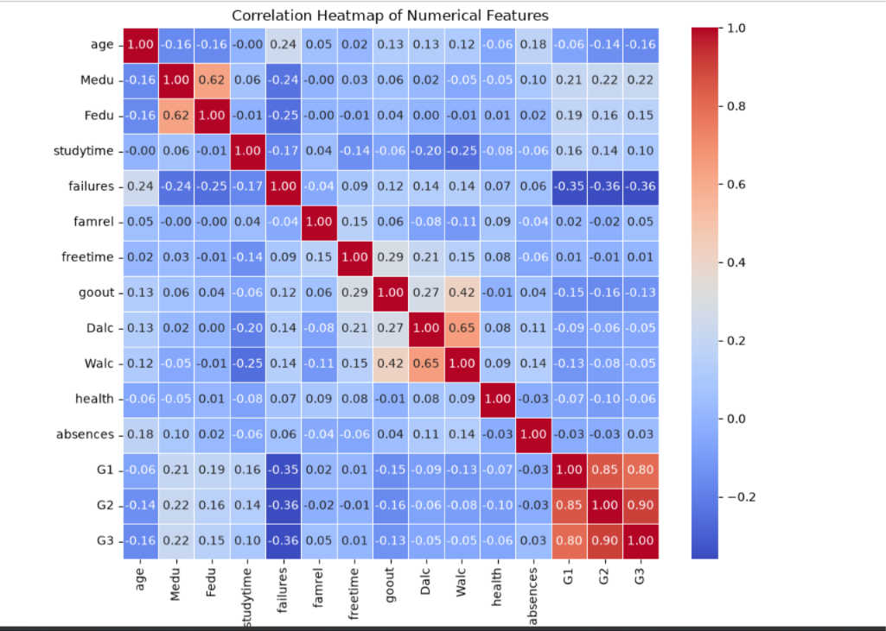
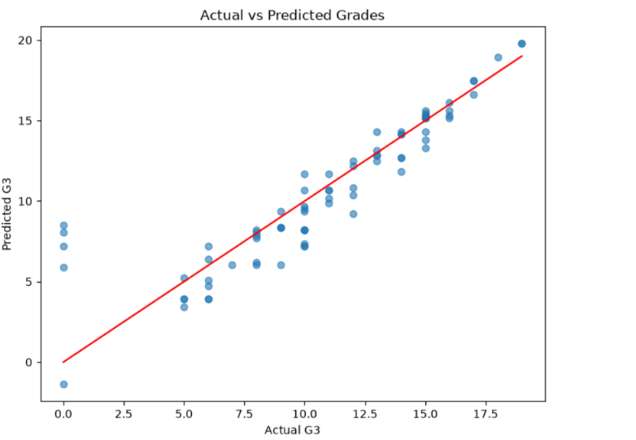
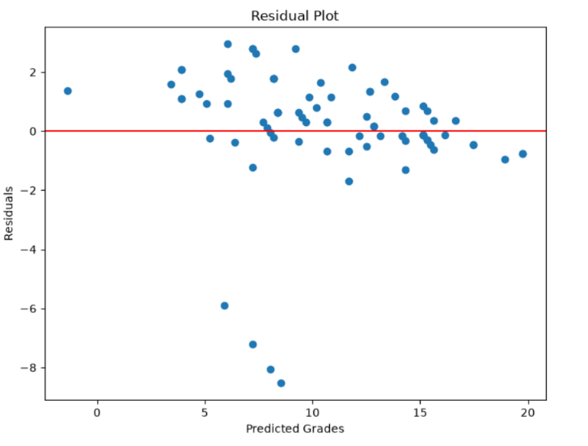

# Student Performance Prediction System

A Machine Learning project that predicts a student's final grade (G3) based on academic and behavioral features using the UCI Student Performance Dataset.

---

## 📌 Project Overview

This project builds a regression model to predict student final grades. Multiple feature selection strategies and machine learning algorithms were compared to identify the best performing model.

**Final Selected Model:** Linear Regression using G1 and G2 (previous period grades)

---

## 🎯 Objectives

- Analyze student performance data
- Identify important features influencing final grades
- Build and compare machine learning models
- Evaluate models using R², MAE, and RMSE
- Select the best model for prediction

---

## 📁 Dataset

- **Source:** UCI Student Performance Dataset
- **File:** `student-mat.csv`
- **Records:** 395 students
- **Features:** 33 columns
- **Target:** G3 (Final Grade)

---

## 🛠️ Technologies Used

- Python
- Pandas
- NumPy
- Matplotlib
- Seaborn
- Scikit-learn
- Jupyter Notebook

---

## 📊 Feature Selection Approaches

| Approach   | Features Used                          |
|------------|----------------------------------------|
| Easy       | G1, G2                                 |
| Realistic  | G1, G2, studytime, failures, absences  |
| Full       | All features (after encoding)          |

---

## 🤖 Models Trained

1. **Linear Regression** (Easy, Realistic, Full)
2. **Random Forest Regressor** (Easy)

---

## 📈 Results

### Linear Regression Comparison

| Model      | R²     | MAE    | RMSE   |
|------------|--------|--------|--------|
| Easy       | 0.795  | 1.262  | 2.053  |
| Realistic  | 0.782  | 1.339  | 2.113  |
| Full       | 0.724  | 1.647  | 2.374  |

### Linear Regression vs Random Forest (Easy Features)

| Model              | R²     | MAE    | RMSE   |
|--------------------|--------|--------|--------|
| Linear Regression  | 0.795  | 1.262  | 2.053  |
| Random Forest      | 0.770  | 1.365  | 2.174  |

**Best Model:** Linear Regression (Easy) – G1 + G2

---

## 📊 Visualizations

### Correlation Heatmap


### Actual vs Predicted Grades


### Residual Plot


---

## 🔑 Key Findings

- Previous grades (G1 and G2) are the strongest predictors of final grade.
- G2 has a much higher influence than G1 (Coefficient: 0.994 vs 0.163).
- Adding more features did not improve model performance.
- Linear Regression outperformed Random Forest on this dataset.
- Residuals are mostly centered around zero, indicating a good model fit.

---

## 📂 Project Structure

```
student-performance-prediction/
│
├── data/
│   └── student-mat.csv
│
├── 001_data_understanding.ipynb
│
├── images/
│   ├── CorrelationHeatMap.png
│   ├── Actual_Vs_Predicted_Grades.png
│   └── Residual_Plot.png
│
├── report/
│   └── Student_Performance_Prediction_Project_Report.docx
│
├── README.md
└── requirements.txt
```

---

## 🚀 How to Run

1. Clone the repository
2. Install dependencies:
   ```bash
   pip install pandas numpy matplotlib seaborn scikit-learn jupyter
   ```
3. Open the Jupyter Notebook and run all cells

---

## 📝 Prediction Example

```python
def predict_grade(g1, g2):
    student = pd.DataFrame({"G1": [g1], "G2": [g2]})
    prediction = lr_easy.predict(student)
    return prediction[0]

print(predict_grade(15, 19))
```

---

## 👨‍💻 Author

**Kota Uday Kiran**  
AI / Machine Learning Intern

---

## 📄 License

This project was developed as part of an internship assignment.
